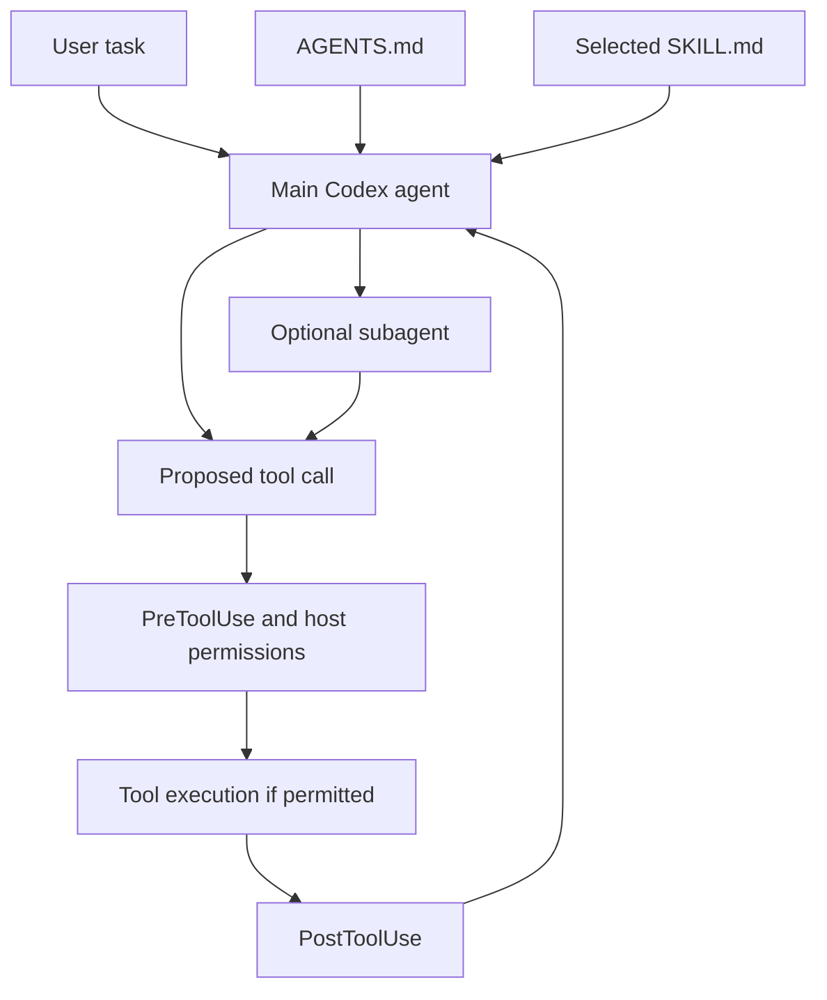

# Coding Agents Guide: Codex

Build a Codex setup that a teammate can understand, reproduce, and verify.
This guide explains what each extension does, how to create it, what each
configuration field means, and where to put it on Windows and Linux.

**Checked against official documentation on November 11, 2026.** Examples target
local Codex clients: CLI, IDE extension, and the desktop app. Cloud execution
has a separate section. The CLI found on this machine reports `0.147.0`; the
extension or app can bundle a different runtime. Check the client you actually
use before adopting a newer option.

The existing [concepts](coding-agent-guide.md), [repository setup](agents-codex.md),
and [short authoring reference](create-codex.md) remain available. This guide is
the standalone, Codex-focused walkthrough. Its examples are documentation;
reading it does not install or activate any configuration.

## Contents

1. [Choose the right mechanism](#1-choose-the-right-mechanism)
2. [Understand files, locations, and precedence](#2-understand-files-locations-and-precedence)
3. [Prepare a project on Windows or Linux](#3-prepare-a-project-on-windows-or-linux)
4. [Write AGENTS.md instructions](#4-write-agentsmd-instructions)
5. [Create a skill](#5-create-a-skill)
6. [Create a specialist subagent](#6-create-a-specialist-subagent)
7. [Create lifecycle hooks](#7-create-lifecycle-hooks)
8. [Configure Codex itself](#8-configure-codex-itself)
9. [Add tools, MCP, and command rules](#9-add-tools-mcp-and-command-rules)
10. [Reuse the setup across all your projects](#10-reuse-the-setup-across-all-your-projects)
11. [Understand local and cloud execution](#11-understand-local-and-cloud-execution)
12. [Map the examples to this repository](#12-map-the-examples-to-this-repository)
13. [Verify and troubleshoot](#13-verify-and-troubleshoot)
14. [Source map and maintenance](#14-source-map-and-maintenance)

## 1. Choose the right mechanism

Suppose your team wants Codex to explain a file, ask a specialist to inspect it,
and reject one recognized tool operation. These are three different jobs.

| Mechanism | Responsibility | Example |
| --- | --- | --- |
| `AGENTS.md` | Durable instructions for working in a repository or directory | Keep imports together; preserve source notebooks |
| Skill | A reusable procedure loaded for a relevant task | Explain one file in a fixed sequence |
| Subagent | A delegated assistant with its own working conversation | Inspect one module and return findings |
| Hook | Code called by the host at a lifecycle event | Reject a matching pending tool call |
| Tool | An executable operation with a typed input contract | Count words in a string |
| MCP server | Makes tools and other capabilities available to Codex | Expose a local Python function |
| `config.toml` | Selects runtime settings and connections | Enable subagents; register an MCP server |
| Sandbox and approvals | Control what execution is permitted | Limit writes to the workspace |
| Command rule | Matches command prefixes in execution policy | Require approval for a particular command |

“Self-agent” is not a separate configuration format here. The relevant Codex
term is **subagent**; a reusable named specialist is a **custom agent**.



The diagram groups permission checks conceptually; it is not a claim that every
tool follows one identical internal sequence. A hook cannot observe every hosted
tool, and post-execution feedback cannot reverse an operation.

Keep three meanings of **argument** separate throughout this guide:

- **Configuration field:** `description` in a skill header or `timeout` in a hook
  registration. You write it when configuring the mechanism.
- **Task input:** the file path or audience you put in a request to a skill or
  specialist. These are natural-language inputs unless you build a parser.
- **Tool argument:** a named, validated value such as `text` in `count_words`.
  The tool's schema defines it.

An instruction such as “do not edit” guides the model. It does not create a
filesystem sandbox. Use the host's permission controls when you need an enforced
access boundary. See [customization](https://learn.chatgpt.com/docs/customization/overview)
and [sandbox and approvals](https://learn.chatgpt.com/docs/agent-approvals-security).

## 2. Understand files, locations, and precedence

### 2.1 Which file is which?

| File | Format | What belongs in it |
| --- | --- | --- |
| `AGENTS.md` | Markdown | Working instructions; no required metadata schema |
| `AGENTS.override.md` | Markdown | Alternative instructions at the same directory level |
| `.codex/config.toml` | TOML | Project runtime configuration |
| `.codex/hooks.json` | JSON | Hook events, matchers, and handlers |
| `.codex/hooks/*.py` | Python in these examples | Executable hook implementation; this directory name is a convention |
| `.agents/skills/<name>/SKILL.md` | YAML front matter followed by Markdown | Skill identity, selection description, and procedure |
| `.agents/skills/<name>/agents/openai.yaml` | YAML | Optional skill presentation, invocation policy, and dependencies |
| `.codex/agents/<name>.toml` | TOML | One custom agent definition |
| `.codex/rules/*.rules` | Starlark | Command-prefix execution policy |
| `requirements.toml` | TOML | Administrator-enforced constraints, deployed through managed locations |
| `<profile>.config.toml` | TOML | A personal configuration profile selected by the CLI |
| `.vscode/settings.json` | JSON/JSONC | VS Code settings, including extension-specific UI options |

**What about `settings.yaml`?** The verified Codex configuration entry point is
`config.toml`. There is no general Codex `settings.yaml` setup step in these
sources. If a repository has that filename, inspect the program that reads it.
YAML is used in the skill header and `agents/openai.yaml`; neither replaces
`config.toml`. Likewise, `.env` configures applications that load it, rather than
automatically configuring Codex. In this course, `.env` and `models.toml` belong
to the course model factory.

### 2.2 Project versus personal locations

`<repo>` means the checked-out project root. Default personal locations are:

| Element | Shared with this project | Windows: current user | Linux: current user |
| --- | --- | --- | --- |
| Instructions | `<repo>/AGENTS.md` | `%USERPROFILE%\.codex\AGENTS.md` | `~/.codex/AGENTS.md` |
| Configuration | `<repo>/.codex/config.toml` | `%USERPROFILE%\.codex\config.toml` | `~/.codex/config.toml` |
| Skills | `<repo>/.agents/skills/<name>/SKILL.md` | `%USERPROFILE%\.agents\skills\<name>\SKILL.md` | `~/.agents/skills/<name>/SKILL.md` |
| Custom agents | `<repo>/.codex/agents/<name>.toml` | `%USERPROFILE%\.codex\agents\<name>.toml` | `~/.codex/agents/<name>.toml` |
| Hooks | `<repo>/.codex/hooks.json` | `%USERPROFILE%\.codex\hooks.json` | `~/.codex/hooks.json` |
| Hook scripts, by convention | `<repo>/.codex/hooks/` | `%USERPROFILE%\.codex\hooks\` | `~/.codex/hooks/` |
| Command rules | `<repo>/.codex/rules/*.rules` | `%USERPROFILE%\.codex\rules\*.rules` | `~/.codex/rules/*.rules` |
| Profile named `review` | Select a personal profile; do not put it here | `%USERPROFILE%\.codex\review.config.toml` | `~/.codex/review.config.toml` |

`CODEX_HOME` changes the Codex home location from its default `.codex` directory.
Use the effective location for user configuration, instructions, agents, and
state. The documented personal skill location is independently
`$HOME/.agents/skills`. Installed clients and installers can also expose skills
under a Codex-managed `.codex/skills` tree; this session includes such skills.
For a new manually authored personal skill, use the documented `.agents/skills`
location and verify discovery rather than assuming every client scans identical
legacy paths.

On Windows, `%USERPROFILE%` is notation used by `cmd.exe` and documentation.
In PowerShell use `$env:USERPROFILE`. On Linux, `~` expands to the current user's
home directory in the shell. Windows Codex and Codex inside WSL can have
different homes, executables, and configuration.

Sources: [configuration locations](https://learn.chatgpt.com/docs/config-file/config-advanced#config-and-state-locations),
[skill discovery](https://learn.chatgpt.com/docs/build-skills#where-to-save-skills),
[custom agents](https://learn.chatgpt.com/docs/agent-configuration/subagents#custom-agents),
and [hook discovery](https://learn.chatgpt.com/docs/hooks#where-codex-looks-for-hooks).

### 2.3 There are several different precedence rules

For ordinary **configuration values**, the documented order, strongest first, is:

1. CLI flags and `--config` overrides.
2. Trusted project `.codex/config.toml` files; the one closest to the working
   directory wins for a conflicting value.
3. The personal profile selected with `--profile`.
4. Personal `config.toml`.
5. Workspace cloud-managed defaults, when supplied.
6. System defaults.
7. Built-in defaults.

Administrator requirements constrain these choices; they are not merely another
user-overridable default. Project configuration also cannot set every user-only
option. For example, configure providers and credentials at the user or managed
level rather than using project config to redirect authentication.

Do not apply this scalar-setting order to every extension:

| Mechanism | How multiple definitions behave |
| --- | --- |
| `AGENTS.md` | Instructions accumulate from global guidance and root toward the working directory; more specific applicable guidance takes precedence |
| Same-directory `AGENTS.override.md` | Selected before `AGENTS.md`; they are not both appended at that level |
| Hooks | Matching handlers from active sources accumulate; a project hook does not replace the user's hook |
| Skills with the same name | They are not merged; both can appear in selectors; prefer unique names |
| Skill enable/disable entries | Last matching `skills.config` entry wins |
| Custom agent matching a built-in name | The custom definition takes precedence over that built-in role |

Project trust activates project configuration; each non-managed hook also needs
review and trust of its current definition. Reading a file in chat is not an
activation step. See [configuration precedence](https://learn.chatgpt.com/docs/config-file/config-basic#configuration-precedence).

## 3. Prepare a project on Windows or Linux

For the walkthrough, use an existing Git repository and a working Codex
installation. The hook example additionally needs Python and Git on the PATH
visible to the Codex process. The examples do not need Docker, a course model,
or notebook execution.

Create only the directories you need. Existing files must be edited or merged;
do not replace them wholesale with the examples below. In this repository,
`AGENTS.md`, `config.toml`, and `hooks.json` already contain working policies.

### Windows: PowerShell

```powershell
Set-Location 'F:\Gildia_AI\agentic_ai'
codex --version
Get-Command codex, python, git

$projectDirs = @(
    '.codex',
    '.codex/agents',
    '.codex/hooks',
    '.codex/rules',
    '.agents/skills/explain-file/agents'
)
foreach ($directory in $projectDirs) {
    New-Item -ItemType Directory -Path $directory -Force | Out-Null
}
```

Replace the project path for your own checkout. Open the files individually in
your editor and paste the corresponding examples in sections 4–8:

```powershell
notepad AGENTS.md
notepad .codex/config.toml
notepad .agents/skills/explain-file/SKILL.md
notepad .agents/skills/explain-file/agents/openai.yaml
notepad .codex/agents/file_reviewer.toml
notepad .codex/hooks/check_marker.py
notepad .codex/hooks.json
```

Save text as UTF-8. If you use a Python launcher rather than `python`, adjust
the hook's `commandWindows` and the local verification commands accordingly.
Protected configuration paths can require a host approval when Codex itself
edits them; creating directories manually in your editor or terminal does not
activate or trust their contents.

### Linux: Bash

```bash
cd /path/to/your/repository
codex --version
command -v codex python3 git
mkdir -p .codex/agents .codex/hooks .codex/rules
mkdir -p .agents/skills/explain-file/agents
```

Use your preferred editor; for example:

```bash
nano AGENTS.md
nano .codex/config.toml
nano .agents/skills/explain-file/SKILL.md
nano .agents/skills/explain-file/agents/openai.yaml
nano .codex/agents/file_reviewer.toml
nano .codex/hooks/check_marker.py
nano .codex/hooks.json
```

The Python hook is launched through the interpreter, so it does not need an
executable bit or a shebang. After saving configuration, start a fresh Codex
session in the checkout and complete the host's project and hook trust flow.

## 4. Write AGENTS.md instructions

### Purpose and creation

Use `AGENTS.md` for facts and working agreements that apply repeatedly: the
test command, source layout, language conventions, and when to use specialists.
Keep long task-specific procedures in skills.

Create `<repo>/AGENTS.md`, or merge these ideas into an existing one:

```markdown
# Repository instructions

- Read the relevant source before changing it.
- Keep documentation, comments, and examples in English.
- Preserve unrelated uncommitted changes.
- After changing Python source, run the relevant tests.
- Use the explain-file skill for requests to explain a repository file.
- Delegate explicit file reviews to file_reviewer and wait for its report.
```

The last two bullets are **routing instructions**. They refer to definitions you
create separately. Mentioning a skill or agent does not create it.

### Inputs and controls, one at a time

`AGENTS.md` is prose, not a function or a YAML object. It has **no required
`name`, `description`, or `arguments` fields**. Headings are for readers.

| Item | Type / requirement | Function |
| --- | --- | --- |
| Filename `AGENTS.md` | Recognized filename | Makes the instructions discoverable in that scope |
| File body | Markdown text | Tells the agent how to work; write concrete actions and conditions |
| Directory | Filesystem location | Determines which project or subtree the instructions concern |
| `AGENTS.override.md` | Optional alternative file | Takes priority over the normal filename at the same level |
| `project_doc_fallback_filenames` | Optional array in `config.toml` | Additional names to try after the normal instruction filenames |
| `project_doc_max_bytes` | Optional number in `config.toml` | Limits the discovered instruction content; documented default is 32 KiB |

For example, a repository with `AGENTS.md` and `services/payments/AGENTS.md`
can give payment-specific testing instructions when working in that directory.
Codex discovers instructions from the project root toward the current working
directory, with global guidance first. Discovery is not a recursive load of
every instruction file in every sibling directory.

Optional discovery settings:

```toml
project_doc_fallback_filenames = ["TEAM_GUIDE.md"]
project_doc_max_bytes = 65536
```

Here `TEAM_GUIDE.md` is an alternate instruction filename, not a skill. Increasing
the byte limit allows more instruction text; it does not improve instructions
that are contradictory or unrelated to the task.

### Verify

Start a fresh session from the intended directory. Ask Codex to identify the
applicable instruction files and summarize the relevant rules. Then request a
small task that exercises one rule and inspect its behavior. A summary confirms
awareness; it does not prove every future action will follow prose instructions.

Source: [Custom instructions with AGENTS.md](https://learn.chatgpt.com/docs/agent-configuration/agents-md).

## 5. Create a skill

### Purpose and minimum working example

A skill packages a repeatable procedure. Codex initially sees its identity and
description, then loads the complete instructions when the skill is selected.
Optional scripts and reference files are read or executed when needed; they do
not run simply because the folder exists.

Create `.agents/skills/explain-file/SKILL.md`:

```markdown
---
name: explain-file
description: Explain a named repository file with source references and one concrete input-to-output example. Use for code explanations, not edits or reviews.
---

# Explain one file

Inputs:
- A repository file path.
- An optional audience description; default to basic Python knowledge.

1. Read applicable AGENTS.md instructions and the requested file.
2. If the path is missing or ambiguous, ask for it.
3. State the problem the file solves in one sentence.
4. Explain the main execution steps with line or notebook-cell references.
5. Trace one small input through those steps.
6. Identify assumptions and distinguish code reading from observed execution.

Do not edit files or run model-backed examples for this explanation.
Return the explanation in the current conversation.
```

Invoke it in Codex chat, not a shell:

```text
$explain-file model_config.py — audience: basic Python
```

For assisted creation, invoke the built-in `$skill-creator` in Codex chat and
describe the workflow, trigger, inputs, and expected output. Review the resulting
files using the same field explanations below.

### SKILL.md fields

#### `name`

Required non-empty string in the YAML header. It identifies the skill and is
used in explicit mentions such as `$explain-file`. Use a short, distinctive
lowercase hyphenated name and match the directory name for clarity. A filename
alone does not replace this field.

#### `description`

Required non-empty string in the YAML header. It tells Codex **when to select
the skill**, so include the task, relevant inputs, and boundaries. “Helps with
files” is too broad; the example distinguishes explanations from edits and
reviews. Keep the important trigger near the beginning because long catalogs
can shorten descriptions. Plugin validation currently limits descriptions to
1,024 characters.

#### Markdown body

The text after the closing `---` is the procedure, not another YAML field.
Define input handling, steps, output, and execution constraints here. A heading
called `Inputs` is our authoring convention; it does not create a typed API.

#### Optional descriptive metadata

Some skill packages include a `metadata` mapping for descriptive information.
It does not configure the skill picker, grant tools, or establish a sandbox.
The portable minimum used here needs only `name`, `description`, and the body.
Use the supported `agents/openai.yaml` fields below for Codex-specific behavior;
do not assume arbitrary front-matter keys have runtime effects.

### Task inputs are not header fields

| Task input in this example | Required? | How the instructions use it |
| --- | --- | --- |
| File path | Yes, before the explanation proceeds | Selects the file to read; the skill asks when it is missing |
| Audience | No | Adjusts terminology and detail; defaults to basic Python |

These inputs are ordinary request text. There is no automatic `$ARGUMENTS`
replacement or agent-spawning switch established by this example.

### Optional agents/openai.yaml

Create `.agents/skills/explain-file/agents/openai.yaml` if you want presentation
metadata or explicit-only invocation:

```yaml
interface:
  display_name: "Explain a file"
  short_description: "Trace repository code with a concrete example"
  default_prompt: "Use $explain-file to explain model_config.py."
policy:
  allow_implicit_invocation: false
```

Every field has a separate role:

| Field | Type / requirement | Function and example |
| --- | --- | --- |
| `interface` | Mapping when defining presentation | Container for the fields below; not an agent definition |
| `interface.display_name` | String; include it when supplying interface metadata | Friendly picker label, such as `Explain a file` |
| `interface.short_description` | String; include it with the label | Short UI explanation of the skill's job |
| `interface.default_prompt` | Optional string | Suggested starting request; it does not execute the skill automatically |
| `interface.icon_small` | Optional relative asset path | Small UI icon; the referenced file must exist |
| `interface.icon_large` | Optional relative asset path | Larger UI artwork; for example `./assets/icon.png` |
| `interface.brand_color` | Optional string | Six-digit hex color such as `#2673B8` |
| `policy` | Optional mapping | Container for invocation and distribution policy |
| `policy.allow_implicit_invocation` | Optional boolean; default `true` | `false` prevents automatic selection from the task; explicit mention still works |
| `policy.products` | Optional array in plugin skill metadata | Product targeting using `CHAT`, `CODEX`, or both; omit for an ordinary local skill unless needed |
| `dependencies` | Optional mapping | Declares capabilities the workflow needs |
| `dependencies.tools` | Optional list of objects | One entry per declared tool dependency |
| `dependencies.tools[].type` | String in each dependency | `mcp` for an MCP dependency |
| `dependencies.tools[].value` | String in each dependency | Dependency identifier, such as `openaiDeveloperDocs` |
| `dependencies.tools[].description` | Descriptive string | Explains why that connection is needed |
| `dependencies.tools[].transport` | Transport string when declaring it | `streamable_http` in the documented HTTP example |
| `dependencies.tools[].url` | URL when declaring an HTTP endpoint | Address of the server, such as `https://developers.openai.com/mcp` |

The interface file is optional. Plugin submission validation imposes additional
requirements when you include it, including non-empty display name and short
description. Dependency metadata does not define the server's tool argument
schemas or bypass connection approval.

### Supporting files and verification

```text
explain-file/
  SKILL.md
  agents/openai.yaml       optional presentation and policy
  references/             optional longer explanations
  scripts/                optional executable helpers
  assets/                 optional templates or images
```

Reference supporting files from `SKILL.md` and explain when to use them. Keep
task instructions short enough to understand without reading every reference.

Verify explicit invocation with `$explain-file model_config.py`. With the
example policy, a generic explanation request should not implicitly activate
this skill. If you want implicit selection, set the flag to `true`, then test
both a matching request and an unrelated one. Confirm discovery in the client's
skill picker; restart if a change does not appear.

Sources: [Build skills](https://learn.chatgpt.com/docs/build-skills) and
[plugin skill validation](https://developers.openai.com/plugins/deploy/submission-errors).

## 6. Create a specialist subagent

### Purpose and creation

A skill changes the procedure followed by the current agent. A subagent gives a
bounded task to another agent thread and returns its result to the parent.
Delegation is useful when a separate investigation can return a concise report.
It also consumes additional model and tool work.

Create `.codex/agents/file_reviewer.toml`:

```toml
name = "file_reviewer"
description = "Inspect a named repository file for concrete correctness problems."
developer_instructions = """
Read applicable AGENTS.md instructions, the named file, and relevant callers.
Do not edit files. Do not run model services or install dependencies.
Return confirmed findings with source references and the smallest useful fix.
If no supported finding exists, say so and explain the inspection limits.
You are not alone in the codebase; preserve other people's changes.
"""
```

The file defines the specialist; it does not start it. Request delegation:

```text
Delegate a reading-only review of model_config.py to file_reviewer.
Wait for its report, then summarize the confirmed findings.
```

An applicable `AGENTS.md` or skill can also explicitly request delegation.
Simply creating an agent file is not a request to spawn it for every task.

### Required agent fields

#### `name`

Required string. This is the identity used to select the custom agent. Prefer
`file_reviewer.toml` for `name = "file_reviewer"`, although the `name` field is
the identity source. Avoid reusing a built-in name unless you intend to replace
that built-in role.

#### `description`

Required string. Explains when this specialist is appropriate. It should describe
the task and scope, not repeat the entire procedure.

#### `developer_instructions`

Required string, often a multiline TOML string. Defines the specialist's
responsibility, allowed workflow, output, and limits. “Do not edit” here is an
instruction. It does not make the inherited filesystem permissions read-only.

### Optional agent fields

| Field | Type | Effect |
| --- | --- | --- |
| `model` | Available model identifier string | Overrides the resolved model for this custom agent |
| `model_reasoning_effort` | Model-supported string | Selects effort; available values depend on model/client, for example `low`, `medium`, `high`, `xhigh`, `max`, `ultra` |
| `model_reasoning_summary` | `auto`, `concise`, `detailed`, or `none` | Requests supported reasoning-summary detail; does not expose hidden reasoning |
| `model_verbosity` | `low`, `medium`, or `high` | Requests supported response verbosity; model support varies |
| `features.shell_tool` | Boolean | Set `false` to disable the supported shell capability |
| `features.apps` | Boolean | Set `false` to disable the supported apps capability |
| `features.plugins` | Boolean | Set `false` to disable the supported plugins capability |
| `features.memories` | Boolean | Set `false` to disable the supported memories capability |
| `features.request_permissions_tool` | Boolean | Set `false` to disable that permission-request tool capability |
| `skills.config` | Array of tables | Enable/disable inherited skills using the selectors below |
| `skills.config[].name` | String; alternative to `path` | Matches skills with this exact name |
| `skills.config[].path` | Absolute path; alternative to `name` | Matches one `SKILL.md` |
| `skills.config[].enabled` | Boolean | Whether the selected skill remains enabled |
| `skills.bundled.enabled` | Boolean | Set `false` to disable bundled system skills |
| `skills.include_instructions` | Boolean | Set `false` to omit the automatic skill instruction block |

Use one selector, `name` or `path`, per `skills.config` entry. These controls
reduce supported capabilities; they are not a universal per-tool allowlist.
Parent permissions, provider, and MCP connections remain inherited. Putting
`sandbox_mode`, `approval_policy`, `model_provider`, or `mcp_servers` in a custom
agent file does not override those parent settings.

### Session-level agent configuration

Merge this table into `.codex/config.toml` or the personal config:

```toml
[agents]
enabled = true
max_concurrent_threads_per_session = 2
interrupt_message = true
```

| Field | Type / default | Function |
| --- | --- | --- |
| `agents.enabled` | Boolean; default `true` | Makes multi-agent tools available |
| `agents.max_concurrent_threads_per_session` | Number; host chooses when omitted | Caps concurrently open spawned threads, excluding the main thread |
| `agents.default_subagent_model` | Optional string | Default model selection for spawned agents |
| `agents.default_subagent_reasoning_effort` | Optional string | Default supported effort for spawned agents |
| `agents.interrupt_message` | Boolean; default `true` | Adds a model-visible interruption message when an agent turn is interrupted |
| `agents.max_threads` | Legacy numeric alias | Older spelling for the concurrency limit; prefer the current field |

The configuration reference also lists role entries:

| Field | Type | Function |
| --- | --- | --- |
| `agents.<role>.description` | String | Supplies role-selection text for this registration style |
| `agents.<role>.config_file` | Path string | Points to a TOML layer; relative paths resolve from the declaring configuration file |

This guide uses standalone `.codex/agents/*.toml` definitions instead. Do not
register the same role through multiple mechanisms without checking your
client's behavior.

Model/effort resolution is more specific than “always inherit”: explicit spawn
settings take precedence over `[agents]` defaults, which take precedence over
parent values. A custom agent file's own model/effort settings then override
those resolved values. An explicitly selected model can receive its default
effort if no effort was supplied. Set model and compatible effort together when
you need a deliberate override; omission is simplest for inheritance.

### Inputs to a delegated task

These are items to supply in the request, not extra TOML keys:

| Task input | Why it matters |
| --- | --- |
| Specialist name | Selects the role, such as `file_reviewer` |
| Objective | Gives a concrete question or output to produce |
| Paths / ownership | Bounds what it inspects or owns; prevents overlapping edits |
| Audience | Adjusts a teaching review to the intended reader |
| Execution constraints | Says whether tests, services, network, or GPU work may run |
| Completion/report requirement | Tells the parent what to wait for and what evidence to collect |

The parent uses its available delegation tools; their runtime schemas can vary
between clients. Do not paste an internal tool call into `config.toml` as though
it were a configuration field. In the CLI, `/subagents` lets you inspect agent
threads. Verify an actual delegated report, not just that the TOML parses.

Source: [Subagents](https://learn.chatgpt.com/docs/agent-configuration/subagents).

## 7. Create lifecycle hooks

### 7.1 Purpose and execution model

A hook is executable behavior triggered by Codex at an event. For example,
`PreToolUse` can reject a supported call before execution; `PostToolUse` can add
feedback after execution. The host invokes the hook, rather than asking the
model to remember to call it.

For a command hook, the protocol is:

```text
Codex event -> JSON on script stdin -> hook script -> JSON on stdout -> Codex
```

The hook script must be available in the execution environment. Its registration,
process launch, output format, and trust state all matter.

### 7.2 Create a harmless demonstration handler

Save as `.codex/hooks/check_marker.py`. This example blocks a distinctive marker
in a shell command. It demonstrates the protocol; it is not a deletion or shell
security policy.

```python
"""Block a harmless marker to demonstrate the PreToolUse protocol."""

import json
import sys


event = json.load(sys.stdin)
tool_input = event.get("tool_input", {})
command = ""
if isinstance(tool_input, dict):
    command = tool_input.get("command", tool_input.get("cmd", ""))

output = {}
if isinstance(command, str) and "DOCS_HOOK_PROBE" in command:
    output = {
        "hookSpecificOutput": {
            "hookEventName": "PreToolUse",
            "permissionDecision": "deny",
            "permissionDecisionReason": "The documentation probe was blocked.",
        }
    }

print(json.dumps(output))
```

`event` is the parsed stdin object. `tool_input` contains the pending operation's
arguments. `command` supports the documented normalized `command` field and the
`cmd` form handled by this repository. The script inspects text; it never
executes that text. `{}` means no hook decision; it does not override other
hooks or host permissions.

### 7.3 Register it in hooks.json

This is a complete configuration for a fresh example project. In an existing
file, add its matcher group to the current `PreToolUse` array.

```json
{
  "description": "Documentation hook demonstration",
  "hooks": {
    "PreToolUse": [
      {
        "matcher": "^(Bash|exec_command)$",
        "hooks": [
          {
            "type": "command",
            "command": "python3 -I \"$(git rev-parse --show-toplevel)/.codex/hooks/check_marker.py\"",
            "commandWindows": "python -I \"$(git rev-parse --show-toplevel)/.codex/hooks/check_marker.py\"",
            "timeout": 10,
            "async": false,
            "statusMessage": "Checking the documentation probe"
          }
        ]
      }
    ]
  }
}
```

The commands resolve the repository root so they work when Codex starts in a
subdirectory. Git and Python must be available. Hooks run with the session's
working directory, not automatically beside `hooks.json`.

### 7.4 Registration fields, individually

| Field | Type / requirement | Function |
| --- | --- | --- |
| `description` | Optional top-level string | Documents this hook file; does not affect selection |
| `hooks` | Top-level event mapping | Groups registrations by lifecycle event |
| `hooks.<Event>` | Array of matcher groups | Lists registrations for one event, such as `PreToolUse` |
| `hooks.<Event>[].matcher` | Optional regex string | Filters the event's supported match value; omit to match all |
| `hooks.<Event>[].hooks` | Array of handlers | Lists the command or MCP handlers for this group |
| Handler `type` | Required discriminator | `command` launches a process; `mcp_tool` calls an existing MCP connection |
| Handler `command` | String for a command handler | Shell command that launches the script |
| Handler `commandWindows` | Optional string | Windows-specific launcher override; TOML also accepts `command_windows` |
| Handler `timeout` | Optional seconds | Default is 600 for most events; `SessionEnd` and `Interrupt` default to 1 and support at most 3 |
| Handler `statusMessage` | Optional string | Progress message shown while the handler runs |
| Handler `async` | Optional boolean; default `false` | Background command execution; background hooks cannot block, approve, rewrite, or continue the triggering operation |
| Handler `additionalContextLimit` | Optional integer | Approximate token threshold for returned additional context; default 2500, `0` disables this context truncation threshold |
| MCP handler `server` | Required string for `mcp_tool` | Name of an already-connected MCP server |
| MCP handler `tool` | Required string for `mcp_tool` | Name of the tool on that server |
| MCP handler `input` | Optional JSON object; default `{}` | Tool arguments, optionally using event-field templates |

`prompt` and `agent` handler types are currently parsed but skipped. They are not
alternatives to a functioning command handler. MCP hooks run synchronously and
do not start missing servers; an unavailable server or hook error is not a
guaranteed denial.

Use one representation per configuration layer: `hooks.json`, or equivalent
inline `[[hooks.PreToolUse]]` and `[[hooks.PreToolUse.hooks]]` tables in
`config.toml`. Defining both merges them and produces a warning. Matching hooks
from different sources all run, and matching command hooks can start concurrently;
one hook is not a sequential prerequisite for another.
`SessionEnd` command hooks always run synchronously, even if `async` is set.

### 7.5 Event selection

| Event | When it runs | What `matcher` examines |
| --- | --- | --- |
| `SessionStart` | A session starts, resumes, clears, forks, or resumes after compaction | `source`: `startup`, `resume`, `clear`, `compact`, `fork` |
| `SessionEnd` | Main session ends | `reason`, currently `other` |
| `UserPromptSubmit` | A user prompt is submitted | Matcher ignored |
| `PreToolUse` | Before a supported tool executes | Tool name and supported aliases |
| `PermissionRequest` | When the host already needs approval | Tool name and supported aliases |
| `PostToolUse` | After a supported tool returns | Tool name and supported aliases |
| `PreModelRequest` | Before each model request attempt | Matcher unsupported |
| `PostModelRequest` | After each model request attempt | Matcher unsupported |
| `PreCompact` | Before conversation compaction | `trigger`: `manual` or `auto` |
| `PostCompact` | After conversation compaction | `trigger`: `manual` or `auto` |
| `SubagentStart` | A subagent starts | `agent_type` |
| `SubagentStop` | A subagent is about to finish | `agent_type` |
| `Stop` | The main agent is about to finish its turn | Matcher ignored |
| `Interrupt` | The user interrupts an active main-thread turn | Matcher ignored |

Current documentation normalizes unified shell execution to `Bash` for hook
matching. This repository includes `exec_command` in its regex for compatibility.
`apply_patch` can also match `Edit` or `Write`, while its payload still identifies
the canonical tool. Match the actual host payload, not a guessed UI label.
Hosted web search is outside the local function-tool hook path. Polling an
existing `write_stdin` session does not repeat `PreToolUse` for the original
command.

### 7.6 Handler input fields

These are **runtime inputs from Codex**, not fields to add to `hooks.json`.

| Field | Type | Meaning |
| --- | --- | --- |
| `session_id` | String | Session identifier; subagent events use the parent session ID |
| `transcript_path` | String or null | Transcript location when available; its contents are not a stable API |
| `cwd` | String | Session working directory |
| `hook_event_name` | String | Event that triggered this call |
| `model` | String | Active model identifier; Codex extension to the event |
| `permission_mode` | String on supported events | Current mode, such as `default`, `acceptEdits`, `plan`, `dontAsk`, or `bypassPermissions`; not an approval-policy config value |
| `turn_id` | String on turn-scoped events | Current turn identifier |
| `tool_name` | String on tool/permission events | Canonical tool identity |
| `tool_use_id` | String on pre/post tool events | Identifier of that tool invocation |
| `tool_input` | Tool-specific JSON | Actual proposed arguments; schema varies by tool |
| `tool_input.command` | String for normalized shell/patch inputs | Shell command text or patch text; not all tools have this field |
| `tool_input.cmd` | Compatibility field used by repository handlers | Raw unified-exec command text when supplied in that form |
| `tool_input.description` | Optional string on approval inputs | Human-readable approval reason when supplied |
| `tool_response` | JSON on `PostToolUse` | Result of the completed operation |
| `source` | String on `SessionStart` | Session-start reason from the event table |
| `reason` | String on `SessionEnd` | Session-end reason |
| `trigger` | String on compaction events | `manual` or `auto` |
| `prompt` | String on `UserPromptSubmit` | Submitted prompt text |
| `agent_id` | String on subagent events; when available on model events | Delegated agent identity |
| `agent_type` | String on subagent events; when available on model events | Delegated role/type |
| `agent_transcript_path` | String or null on `SubagentStop` | Child transcript location |
| `stop_hook_active` | Boolean on stop events | Whether a hook already continued this turn/subagent; useful for preventing endless continuation |
| `last_assistant_message` | String or null on stop events | Most recent assistant response |
| `status` | String on `PostModelRequest` | `completed`, `failed`, or `cancelled` |
| `error` | String or null on `PostModelRequest` | Available request error |
| `token_usage` | Object or null on `PostModelRequest` | Usage information when available |

Only read fields appropriate to the event. MCP arguments are the tool's JSON
arguments; there is no universal `command` inside every `tool_input`.

### 7.7 Handler output fields and decisions

For a synchronous `PreToolUse` denial, emit JSON and exit successfully:

```json
{
  "hookSpecificOutput": {
    "hookEventName": "PreToolUse",
    "permissionDecision": "deny",
    "permissionDecisionReason": "This operation is blocked by the configured policy."
  }
}
```

| Output field | Type | Meaning and support boundary |
| --- | --- | --- |
| `hookSpecificOutput` | Object | Event-specific output container |
| `hookSpecificOutput.hookEventName` | String | Identifies the event whose output shape is being returned |
| `hookSpecificOutput.permissionDecision` | `allow` or `deny` for `PreToolUse` | Allows normal permitted handling or rejects the pending call |
| `hookSpecificOutput.permissionDecisionReason` | String | Explains the pre-tool decision |
| `hookSpecificOutput.updatedInput` | Object with `allow` | Replaces supported tool arguments; normalized shell/patch rewriting requires string `command` |
| `hookSpecificOutput.additionalContext` | String on supported context-producing events | Adds guidance for the model; does not itself run a check |
| `systemMessage` | Optional string | Surfaces a warning/message in the UI or event stream |
| `continue` | Boolean on supported events | Stops that event's normal progression when `false`; not supported for `PreToolUse` or `PermissionRequest` |
| `stopReason` | String on supported events | Explains the corresponding stop behavior |
| `suppressOutput` | Parsed compatibility field | Currently not implemented; omit it |
| `decision` | `block` on relevant events | Event-specific block/feedback/continuation; see below |
| `reason` | String with `decision` | Explanation or continuation instruction |
| `hookSpecificOutput.decision` | Object for `PermissionRequest` | Decision about an approval the host already requested |
| `hookSpecificOutput.decision.behavior` | `allow` or `deny` | Approves or rejects that existing request |
| `hookSpecificOutput.decision.message` | String for an approval denial | Explains why the request was denied |

Do not copy an output shape between events indiscriminately:

- `PreToolUse`: use the explicit denial above. `permissionDecision: "ask"` is
  currently unsupported and can report a hook error while the call continues.
  `continue: false` is also unsupported here. Exit code `2` with a reason on
  stderr is another documented blocking form.
- `PermissionRequest`: uses its `decision.behavior` object. Returning `{}` leaves
  normal approval handling in place. This event cannot create an approval prompt
  for an operation that did not need one. A deny wins over other allow decisions.
- `PostToolUse`: `decision: "block"` substitutes feedback for the completed
  tool's result. It cannot undo writes or other side effects. `continue: false`
  also changes result processing; it is not a pre-execution veto.
- `Stop` and `SubagentStop`: `decision: "block"` asks the agent to continue using
  `reason` as the continuation instruction. Check `stop_hook_active` before
  requesting repeated continuation. `continue: false` takes precedence over
  continuation requests for these events.
- `UserPromptSubmit`: a supported `decision: "block"` rejects the submitted
  prompt. `SessionStart`, `SubagentStart`, and `UserPromptSubmit` can add context;
  `continue: false` does not prevent `SubagentStart` from starting the child.
- `PreCompact` and `PostCompact`: supported `continue: false` stops progression
  before or after compaction respectively. Model-request hook output is
  diagnostic only. `SessionEnd` and `Interrupt` are advisory and cannot restart
  the conversation or prevent the event.

Keep stdout for the event's expected output. Plain text is ignored by pre/post
tool hooks; it is not a denial. Use valid JSON for decisions and stderr for
diagnostics. Malformed output, crashes, and timeouts can leave operations
unguarded. A handler test and a live host probe cover different failure modes.

### 7.8 MCP hook alternative

An MCP handler uses an already-connected server rather than a process command:

```json
{
  "hooks": {
    "PreToolUse": [
      {
        "matcher": "^apply_patch$",
        "hooks": [
          {
            "type": "mcp_tool",
            "server": "policy_service",
            "tool": "inspect_patch",
            "input": {"patch": "${tool_input.command}"},
            "timeout": 10,
            "statusMessage": "Inspecting the proposed patch"
          }
        ]
      }
    ]
  }
}
```

This is a template requiring your own `policy_service.inspect_patch`; this
repository does not supply it. `${tool_input.command}` reads that field from
the event. A placeholder occupying the entire value preserves its JSON type;
embedding it in a longer string produces text. MCP hooks do not prompt for tool
approval or recursively trigger other hooks. `SessionEnd` does not support them.

### 7.9 Test the handler, then test activation

Run a synthetic event through the saved example on Windows:

```powershell
'{"tool_input":{"command":"Write-Output DOCS_HOOK_PROBE"}}' |
    python -I .codex/hooks/check_marker.py
'{"tool_input":{"command":"Write-Output hello"}}' |
    python -I .codex/hooks/check_marker.py
```

On Linux:

```bash
printf '%s\n' '{"tool_input":{"command":"echo DOCS_HOOK_PROBE"}}' |
  python3 -I .codex/hooks/check_marker.py
printf '%s\n' '{"tool_input":{"command":"echo hello"}}' |
  python3 -I .codex/hooks/check_marker.py
```

Expected: the first invocation emits a deny decision; the second emits `{}`.
These tests pass text to the handler without executing the proposed commands.

Then start a fresh local Codex session, trust the project and review the exact
hook in `/hooks` (or the app's hook review/settings UI). Ask Codex to run the
harmless print command containing `DOCS_HOOK_PROBE`. It should be denied before
execution. If the hook is absent, the command only prints a marker. Test an
ordinary print command too. Do not substitute a real destructive command for
this probe.

Source for the event and field contracts:
[Hooks](https://learn.chatgpt.com/docs/hooks). Check that release reference before
using fields found only in a newer development schema.

## 8. Configure Codex itself

### A small config.toml

Use the personal file for your preferences; use the project file for shared,
portable choices. Start with the settings you need:

```toml
approval_policy = "on-request"
sandbox_mode = "workspace-write"

[agents]
enabled = true
max_concurrent_threads_per_session = 2

[features]
hooks = true
```

TOML uses `key = value`, `[table]` for a table, and `[[array_of_tables]]` for
repeated objects. After `[agents]`, following keys belong to that table until
another table begins. Put root-level options before table headers. Do not paste
a second `[agents]` table into a file that already declares one.

### Core fields, individually

| Field | Type / values | Function |
| --- | --- | --- |
| `model` | Available model ID string | Default model; omission keeps the host's selection |
| `model_reasoning_effort` | Model-supported string | Default reasoning effort; see the agent section for examples |
| `model_reasoning_summary` | `auto`, `concise`, `detailed`, `none` | Supported summary preference |
| `model_verbosity` | `low`, `medium`, `high` | Supported answer-length preference |
| `approval_policy` | Common choices `on-request` or `never` | Controls approval prompting; `never` does not grant denied access |
| `approvals_reviewer` | `user` or `auto_review` | Routes eligible approval requests to the user or automatic reviewer; does not change sandbox access |
| `sandbox_mode` | `read-only`, `workspace-write`, `danger-full-access` | Legacy-style filesystem/network sandbox mode; the example uses workspace writes |
| `sandbox_workspace_write.network_access` | Boolean | Network access for sandboxed commands in workspace-write mode; separate from web search |
| `sandbox_workspace_write.writable_roots` | Array of paths | Additional writable roots for this mode |
| `default_permissions` | Named permission profile | Alternative to `sandbox_mode`; do not combine with it or `[sandbox_workspace_write]` |
| `web_search` | `disabled`, `cached`, `indexed`, `live` | Controls the web-search tool's access mode |
| `features.hooks` | Boolean | Enables the hooks feature; hooks still need the applicable trust |
| `windows.sandbox` | `mxc`, `elevated`, `unelevated` | Windows sandbox implementation; availability and policy constrain the choice |
| `features.prefer_mxc` | Boolean | Prefers MXC where supported while permitting the configured legacy fallback |
| `projects.<absolute-path>.trust_level` | `trusted` or `untrusted` | Records project trust; establish it through the host's trust flow |
| `project_doc_fallback_filenames` | Array of strings | Alternative instruction filenames, as explained in section 4 |
| `project_doc_max_bytes` | Number | Instruction discovery byte limit |
| `skills.max_context_tokens` | Positive integer, at most 10000 | Budget for the initial skill catalog, not for each loaded skill body |
| `skills.bundled.enabled` | Boolean | Enables bundled system skills; default `true` |
| `skills.include_instructions` | Boolean | Includes the automatic skill instruction block; default `true` |
| `skills.config` | Array of tables | Per-skill enable/disable rules |
| `skills.config[].name` | String | Selects every skill with that name; use instead of `path` |
| `skills.config[].path` | Absolute path | Selects one `SKILL.md`; use instead of `name` |
| `skills.config[].enabled` | Boolean | Enables or disables the selected skill |

For example, to disable a discovered skill without removing its files:

```toml
[[skills.config]]
name = "explain-file"
enabled = false
```

For granular approval configuration, each boolean controls whether its prompt
category can appear. `false` auto-rejects that category; it does not auto-approve:

| Field | Meaning |
| --- | --- |
| `approval_policy.granular.sandbox_approval` | Sandbox escalation prompts |
| `approval_policy.granular.rules` | Prompts requested by command rules |
| `approval_policy.granular.mcp_elicitations` | MCP requests for user input |
| `approval_policy.granular.request_permissions` | Permission-tool prompts |
| `approval_policy.granular.skill_approval` | Skill-script approval prompts |

Choose the ordinary string policy or the granular object; do not define both
under the same key. Current documentation retires `untrusted` and deprecates
`on-failure`. The inspected `0.147.0` CLI help still lists `untrusted`; that is
a version difference, not a reason to use it in new portable examples.

### Profiles and one-run overrides

Create `review.config.toml` in your effective Codex home:

```toml
model_reasoning_effort = "medium"
approval_policy = "on-request"
```

Select it with:

```text
codex --profile review
```

The current profile format is a separate file. Since Codex `0.134.0`,
`--profile` no longer reads `[profiles.review]` inside the base config.
Project settings and explicit CLI overrides still take precedence over a profile.

Useful CLI arguments are separate from TOML keys:

| Argument | Value | Purpose |
| --- | --- | --- |
| `--profile` / `-p` | Profile name | Loads `<name>.config.toml` from Codex home |
| `--model` / `-m` | Model identifier | Overrides the model for this invocation |
| `--config` / `-c` | `key=value` | Overrides a config key; value is parsed as TOML |
| `--cd` / `-C` | Directory | Selects the working directory and relevant project scope |
| `--sandbox` / `-s` | Supported sandbox mode | Selects the invocation's execution boundary |
| `--ask-for-approval` / `-a` | Supported approval policy | Selects prompting behavior |
| `--strict-config` | No value | In clients that support it, rejects unrecognized configuration fields |

Inspect `codex --help` in the intended client. Prefer dedicated flags for values
that otherwise need complicated shell quoting. A successful `--help` invocation
alone is not proof that your complete configuration loaded successfully.

Sources: [Config basics](https://learn.chatgpt.com/docs/config-file/config-basic),
[Advanced Configuration](https://learn.chatgpt.com/docs/config-file/config-advanced),
[Configuration Reference](https://learn.chatgpt.com/docs/config-file/config-reference),
and [permissions](https://learn.chatgpt.com/docs/permissions).

## 9. Add tools, MCP, and command rules

### 9.1 A tool is an executable contract

The existing [MCP server](../agent_demo/server.py) exposes `count_words`.
Its Python function takes `text: str` and returns an integer. The SDK turns its
signature into a tool schema; the docstring explains when to call it.

| Function argument / result | Type | Meaning |
| --- | --- | --- |
| `text` | Required string | Text to split on whitespace |
| Return value | Integer | Number of resulting pieces |

Example tool arguments: `{"text": "small useful example"}`. The Python result
is `3`; MCP structured output wraps it as `{"result": 3}` in this server.
An empty string yields `0`. This is whitespace counting, not linguistic tokenization.

### 9.2 MCP registration

For a minimal HTTP connection, merge this into the appropriate `config.toml`:

```toml
[mcp_servers.openai_docs]
url = "https://developers.openai.com/mcp"
enabled = true
```

For an existing local server, choose **one** platform variant and substitute
your actual absolute paths. The interpreter must have that server's dependencies.

Windows:

```toml
[mcp_servers.lesson_tools]
command = 'C:\path\to\repository\agent_demo\.venv\Scripts\python.exe'
args = ['C:\path\to\repository\agent_demo\server.py']
enabled_tools = ["count_words"]
startup_timeout_sec = 30
tool_timeout_sec = 10
```

Linux:

```toml
[mcp_servers.lesson_tools]
command = "/path/to/repository/agent_demo/.venv/bin/python"
args = ["/path/to/repository/agent_demo/server.py"]
enabled_tools = ["count_words"]
startup_timeout_sec = 30
tool_timeout_sec = 10
```

These absolute-path examples suit personal configuration. The project's existing
PowerShell launcher resolves its own Git root and is Windows-specific; inspect
it before adapting the configuration for Linux. Do not paste both server tables
with the same name into one file.

### 9.3 MCP fields used when creating connections

All fields below belong under `[mcp_servers.<server-name>]` unless noted.

| Field | Type / default | Function |
| --- | --- | --- |
| `command` | Required string for stdio | Executable that launches the server |
| `args` | Optional array of strings | Separate arguments passed to that executable |
| `cwd` | Optional directory path | Working directory for the server process |
| `env` | Optional map | Environment values assigned to the server; avoid committed secrets |
| `env_vars` | Optional array | Environment variables forwarded to the server |
| `env_vars[].name` | String in object-form entries | Name of the variable to forward |
| `env_vars[].source` | `local` or `remote` | Environment to read it from; remote requires remote stdio support |
| `url` | Required string for HTTP | Server endpoint; use instead of a stdio launcher |
| `auth` | Optional `oauth` or `chatgpt` | Authentication fallback; `chatgpt` applies only to the trusted first-party origin |
| `bearer_token_env_var` | Optional string | Name of an environment variable holding the bearer token |
| `http_headers` | Optional map | Static HTTP headers |
| `env_http_headers` | Optional map | Header names mapped to environment-variable names |
| `http_headers_helper` | Optional command | Produces a JSON header map for supported local HTTP connections |
| `environment_id` | Optional string; default `local` | Selects the execution environment for the connection |
| `enabled` | Optional boolean | Disables a server when `false` without removing its entry |
| `required` | Optional boolean | Makes readiness mandatory for startup when `true` |
| `startup_readiness` | `connection` or `catalog` | Requires a live connection, or allows a valid cached tool catalog for startup; calls still need a connection |
| `startup_timeout_sec` | Seconds; default 10 | Server startup timeout |
| `tool_timeout_sec` | Seconds; default 60 | Timeout for a tool call |
| `enabled_tools` | Optional array of tool names | Restricts exposed tools to this allowlist |
| `disabled_tools` | Optional array of tool names | Excludes tools after applying the allowlist |
| `default_tools_approval_mode` | `auto`, `prompt`, `writes`, `approve` | Server tool approval preference; `writes` prompts for tools not marked read-only, `prompt` requests approval, `approve` permits within policy, `auto` uses automatic handling |
| `tools.<tool-name>.approval_mode` | Same approval-mode values | Overrides the server preference for one tool |
| `tools.<tool-name>.output_token_limit` | Positive integer | Sets that tool's output budget before serialization allowance |
| `scopes` | Optional string array | OAuth scopes requested during authentication |
| `oauth.client_id` | Optional string | Pre-registered OAuth client identity |
| `oauth.client_secret` | Optional secret string | Credential for a confidential OAuth client; keep it out of Git |
| `oauth.callback_url` | Optional URL | Registered callback URL; must agree with the provider's supported callback rules |
| `oauth.callback_port` | Optional port | Listener-port override for this connection |

OAuth callback behavior is provider-sensitive. Use `codex mcp login <name>` and
the exact callback the client reports rather than guessing a URL. The server
registration defines connectivity; individual tools define their own arguments.

Source: [MCP](https://learn.chatgpt.com/docs/extend/mcp).

### 9.4 Command rules

Rules match command prefixes when Codex evaluates execution outside the sandbox.
They are useful for command approval policy. They do not replace a workflow
skill or validate arbitrary shell semantics.

Create `.codex/rules/review.rules` for a trusted project, or place it in the
personal `rules/` directory:

```starlark
prefix_rule(
    pattern = ["gh", "pr", "view"],
    decision = "prompt",
    justification = "Review this repository access before execution.",
    match = ["gh pr view 123"],
    not_match = ["gh issue view 123"],
)
```

| Argument to `prefix_rule` | Type / requirement | Function |
| --- | --- | --- |
| `pattern` | Required non-empty list | Command-prefix tokens; an element can be a list of alternative literal tokens |
| `decision` | Optional; default `allow` | `allow`, `prompt`, or `forbidden`; the most restrictive matching decision wins |
| `justification` | Optional non-empty string | Explains the policy to the reader or approval UI |
| `match` | Optional list; default `[]` | Example command strings that must match when the rule loads |
| `not_match` | Optional list; default `[]` | Example command strings that must not match |

The documented decision order is `forbidden` > `prompt` > `allow`. A rule matches
argument prefixes, not arbitrary substrings. Complex shell wrappers can prevent
the host from decomposing an invocation into individual commands.

In clients exposing the documented checker:

```text
codex execpolicy check --pretty --rules .codex/rules/review.rules -- gh pr view 123
```

This evaluates the rule rather than running `gh`. Check command availability in
your installed client; rules are experimental. Restart Codex after changing rule
files. Source: [Rules](https://learn.chatgpt.com/docs/agent-configuration/rules).

### 9.5 Plugins and other supporting files

A plugin distributes skills and optionally MCP connections, assets, or hooks as
one installable package. A plain local skill does not require a plugin manifest.
For a shared plugin, follow the current
[packaging guide](https://developers.openai.com/plugins/build/plugins): the
portable layout uses `plugin.json`, while Codex compatibility packages can use
`.codex-plugin/plugin.json`. Their MCP/configuration formats are not interchangeable
with `[mcp_servers]` in a user's `config.toml`.

`auth.json`, history, transcripts, caches, and trust records in Codex home are
runtime state. They are not a reusable project setup to copy into Git. Keep
credentials and personal trust decisions local. IDE `settings.json` controls
the extension's supported editor options; it does not replace the runtime TOML
configuration. See [IDE settings](https://learn.chatgpt.com/docs/developer-settings?surface=ide).

## 10. Reuse the setup across all your projects

### 10.1 Choose personal scope first

“For all my projects” usually means the current OS user, not every account on
the computer. Put portable personal preferences in Codex home and personal
skills in `.agents/skills`. Leave repository-specific commands and policies in
the repository.

For the walkthrough examples, these are the source-to-destination changes:

| Project file | Personal destination, relative to the relevant home |
| --- | --- |
| `AGENTS.md` | Merge portable preferences into `<CODEX_HOME>/AGENTS.md` |
| `.codex/config.toml` | Merge desired settings into `<CODEX_HOME>/config.toml` |
| `.agents/skills/explain-file/` | Copy the folder to `<user-home>/.agents/skills/explain-file/` |
| `.codex/agents/file_reviewer.toml` | Copy to `<CODEX_HOME>/agents/file_reviewer.toml` |
| `.codex/hooks/check_marker.py` | Copy to `<CODEX_HOME>/hooks/check_marker.py` |
| `.codex/hooks.json` | Merge registration into `<CODEX_HOME>/hooks.json`, changing script paths |
| `.codex/rules/review.rules` | Copy or merge into `<CODEX_HOME>/rules/review.rules` |

Do not copy the entire project `.codex` folder blindly. Its MCP launcher, hook
script paths, and specialized instructions can depend on the current checkout.

### 10.2 Windows personal setup

From PowerShell, prepare the directories without changing `CODEX_HOME`:

```powershell
$codexUserDir = if ($env:CODEX_HOME) {
    $env:CODEX_HOME
} else {
    Join-Path $env:USERPROFILE '.codex'
}
$personalSkillsDir = Join-Path $env:USERPROFILE '.agents/skills'
foreach ($directory in @(
    $codexUserDir,
    (Join-Path $codexUserDir 'agents'),
    (Join-Path $codexUserDir 'hooks'),
    (Join-Path $codexUserDir 'rules'),
    $personalSkillsDir
)) {
    New-Item -ItemType Directory -Path $directory -Force | Out-Null
}
notepad (Join-Path $codexUserDir 'AGENTS.md')
notepad (Join-Path $codexUserDir 'config.toml')
```

Write portable guidance and merge the settings from section 8. To copy the
example skill after you have created it in the project:

```powershell
$skillDestination = Join-Path $personalSkillsDir 'explain-file'
if (Test-Path -LiteralPath $skillDestination) {
    throw 'The personal skill already exists; compare and merge it manually.'
}
Copy-Item -LiteralPath '.agents/skills/explain-file' -Destination $skillDestination -Recurse
```

For the custom agent, apply the same no-overwrite check:

```powershell
$agentDestination = Join-Path $codexUserDir 'agents/file_reviewer.toml'
if (Test-Path -LiteralPath $agentDestination) {
    throw 'The personal agent already exists; compare and merge it manually.'
}
Copy-Item -LiteralPath '.codex/agents/file_reviewer.toml' -Destination $agentDestination
```

Copy the hook script and optional rule into the destinations in the table using
your editor or file manager, preserving existing files. For the personal hook
registration, replace the repo-root script reference with the **actual absolute
personal path**. For example, a Windows handler can contain:

```json
{
  "type": "command",
  "command": "python -I \"C:/Users/Alex/.codex/hooks/check_marker.py\"",
  "commandWindows": "python -I \"C:/Users/Alex/.codex/hooks/check_marker.py\"",
  "timeout": 10
}
```

Substitute your effective Codex home; `Alex` is a placeholder. Forward slashes
avoid JSON backslash escaping. This is the **handler object**, to place inside
the event/matcher structure from section 7, not a complete `hooks.json`.

### 10.3 Linux personal setup

```bash
codex_user_dir="${CODEX_HOME:-$HOME/.codex}"
personal_skills_dir="$HOME/.agents/skills"
mkdir -p "$codex_user_dir/agents" "$codex_user_dir/hooks" "$codex_user_dir/rules"
mkdir -p "$personal_skills_dir"
nano "$codex_user_dir/AGENTS.md"
nano "$codex_user_dir/config.toml"
```

From the project where you created the walkthrough examples:

```bash
if [ -e "$personal_skills_dir/explain-file" ]; then
  printf '%s\n' 'The personal skill exists; compare and merge it manually.'
else
  cp -R .agents/skills/explain-file "$personal_skills_dir/explain-file"
fi

if [ -e "$codex_user_dir/agents/file_reviewer.toml" ]; then
  printf '%s\n' 'The personal agent exists; compare and merge it manually.'
else
  cp .codex/agents/file_reviewer.toml "$codex_user_dir/agents/file_reviewer.toml"
fi
```

Copy the example hook script and optional rule into the personal destinations
from the table, preserving existing files. Use an absolute path in the handler,
with your actual username and effective Codex home:

```json
{
  "type": "command",
  "command": "python3 -I \"/home/alex/.codex/hooks/check_marker.py\"",
  "timeout": 10
}
```

A personal script must not assume the current project contains its code.
Resolve project-specific data from the event's `cwd` when needed, while resolving
the handler itself from its stable installed path.

### 10.4 Verify personal scope in two projects

Start new sessions in two different trusted repositories. Verify the personal
skill and agent are discoverable in both, run an explicit skill request, and
exercise the harmless hook probe after reviewing its definition. Check whether a
project override changes an ordinary setting. If a personal hook and a project
hook both match, expect both to run; remove unintended duplication through your
normal configuration editing process.

Copying a skill into personal scope while retaining the same project skill can
produce duplicate names. Prefer one source for your own setup or give the
personal variant a distinct name. Do not assume they merge.

### 10.5 Every OS account: administrator-managed setup

Machine-wide defaults are a different scope:

| Purpose | Windows | Linux |
| --- | --- | --- |
| System defaults | `%ProgramData%\OpenAI\Codex\config.toml` | `/etc/codex/config.toml` |
| Enforced requirements | `%ProgramData%\OpenAI\Codex\requirements.toml` | `/etc/codex/requirements.toml` |
| Documented admin skill discovery | Use a managed distribution mechanism supported by the client; do not infer a Windows path from the Linux one | `/etc/codex/skills` |

An administrator deploys reviewed defaults and referenced scripts to these
locations with suitable ownership and permissions. Ordinary system defaults can
be overridden by stronger configuration layers. Requirements enforce allowed
choices and must be protected from modification by the Codex user.

For managed hooks, `hooks.managed_dir` selects the Unix script directory and
`hooks.windows_managed_dir` selects the Windows directory in `requirements.toml`.
`features.hooks = true` can require hooks to remain enabled;
`allow_managed_hooks_only = true` excludes non-managed hook sources. These fields
belong to an administrator policy, not a personal workaround for project trust.

Sources: [managed configuration](https://learn.chatgpt.com/docs/enterprise/managed-configuration),
[hook management](https://learn.chatgpt.com/docs/hooks#managed-hooks-from-requirementstoml),
[system defaults deployment](https://learn.chatgpt.com/docs/enterprise/roll-out-a-gateway),
and [configuration precedence](https://learn.chatgpt.com/docs/config-file/config-basic#configuration-precedence).

## 11. Understand local and cloud execution

The paths in sections 2–10 describe **local** execution. A desktop app can be a
front end to either local or cloud work; the UI location alone does not tell you
where Python, Git, or a hook runs.

| Concern | Local Codex | Cloud task |
| --- | --- | --- |
| Files | Your selected checkout/worktree | Task workspace prepared in the selected environment |
| Personal paths | Your local OS user and effective Codex home | Do not assume your laptop's home or drive letters exist |
| Dependencies | Installed locally | Must be installed/prepared in the cloud environment |
| Secrets | Local credentials and host policy | Environment/personal secret mechanisms and cloud policy |
| Repository guidance | Discovered in the local checkout | Relevant repository files must exist in the remote workspace |
| Hooks and MCP | Local runtime discovery and trust | Support depends on the cloud orchestration/execution model |

For current Codex Cloud, select **Work in > Cloud**, then choose an environment
or create one. A reusable environment selects repositories, prepares dependencies,
and can record an **Install script** and **Start skill**. Review and publish its
prepared state before using it for new tasks. A later republish updates the
reusable setup; existing tasks retain their own state.

| Environment item | Purpose |
| --- | --- |
| Repositories | Code to check out and access in a task |
| Install script | Commands that prepare dependencies and development assets |
| Start skill | Instructions to start services and check readiness |
| Environment variables | Values programs must read directly |
| Network secrets | Credentials substituted by the proxy for allowed HTTPS destinations |
| Access/network settings | Reachable services and allowed users |
| Published filesystem | Prepared starting state for new tasks |

These are environment setup concepts, not new keys to paste into local
`config.toml`. Configure credentials through the cloud environment or personal
vault rather than committing `.env` or copying local `auth.json`.

Work Cloud with local computer access has another important boundary: where
managed enterprise hooks are enabled, cloud orchestration supports supported
global MCP hooks, rather than reading local command hooks or plugin hook
directories. A command running on your computer does not by itself prove that
the cloud coordinator uses your local `hooks.json`. Verify the specific surface.

The official documentation also labels a separate **Codex Cloud (Legacy)**
experience used by some review/integration workflows. Follow the guide matching
your selected environment rather than mixing current and legacy setup fields.

Sources: [Cloud environments](https://learn.chatgpt.com/docs/environments/cloud-environments),
[cloud hook boundaries](https://learn.chatgpt.com/docs/hooks#hooks-with-cloud-orchestration),
and [Codex Cloud Legacy](https://learn.chatgpt.com/docs/environments/cloud-environment).

## 12. Map the examples to this repository

The walkthrough uses new names to make the contracts easy to follow. The actual
checked-out setup already contains:

| Actual file | Its role |
| --- | --- |
| [AGENTS.md](../AGENTS.md) | Teaching conventions and routing to skills/specialists |
| [config.toml](../.codex/config.toml) | Enables subagents, limits spawned threads, registers `lesson_tools` |
| [explain-code/SKILL.md](../.agents/skills/explain-code/SKILL.md) | Interactive explanation in a pirate voice |
| [review-lesson/SKILL.md](../.agents/skills/review-lesson/SKILL.md) | Student-oriented review of one lesson |
| [lesson_reviewer.toml](../.codex/agents/lesson_reviewer.toml) | Delegated lesson review with explicit execution constraints |
| [joke_writer.toml](../.codex/agents/joke_writer.toml) | One actual joke-file write attempt, then reporting the hook result |
| [hooks.json](../.codex/hooks.json) | Three pre-tool registrations and one post-tool registration |
| [git_safety.py](../.codex/hooks/git_safety.py) | Detects and denies selected Git mutations |
| [block_delete.py](../.codex/hooks/block_delete.py) | Detects and denies supported deletion patterns |
| [block_jokes_write.py](../.codex/hooks/block_jokes_write.py) | Denies recognized writes to root `jokes.txt` |
| [notebook_context.py](../.codex/hooks/notebook_context.py) | Adds a validation reminder after recognized notebook edits |
| [server.py](../agent_demo/server.py) | Implements the example MCP tool |

The joke flow illustrates the boundary: instructions request an operation,
the specialist submits it, and the hook denies it. After that denial, the
configured specialist reports the outcome and stops. Delegation does not grant
an exemption from the parent's permissions or the active hooks.

The notebook hook only adds context. It does not execute a notebook, run an
import check, or establish that the notebook works. The Git and deletion
detectors inspect recognized patterns; they are deliberately limited teaching
examples, not a complete operating-system security boundary.

## 13. Verify and troubleshoot

### Verification has layers

| Check | What it proves | What it does not prove |
| --- | --- | --- |
| TOML/JSON/YAML parsing | The file is syntactically valid | The installed client recognizes every key |
| Skill/agent discovery | The host found a definition | The procedure or delegation will be correct |
| Direct synthetic hook invocation | The handler returns the expected response | The host loaded, trusted, and invoked it |
| Harmless live hook probe | That event/tool path is intercepted in that session | Every tool path or future session is covered |
| MCP discovery and a valid call | The server connects and the tool works | Every input or authorization path is correct |
| Source/static checks | The inspected artifact satisfies those checks | A browser, live model, GPU, or cloud workflow ran |

For a newly created setup, work through these steps:

1. Parse the configuration and inspect startup warnings in the intended client.
2. Confirm project trust, then review each non-managed hook definition.
3. Check instructions from both the root and a relevant nested directory.
4. Invoke the skill explicitly and test its selection boundaries.
5. Request one bounded specialist task and wait for its actual report.
6. Exercise both deny and no-decision hook cases, then a harmless live probe.
7. If you configured MCP, inspect its tools and call one with a small valid input.
8. Recheck in another repository if the setup is meant to be personal/global.

Repository checks available here include:

```text
python -m unittest tests.test_coding_agent_patterns tests.test_codex_patterns -v
```

These inspect documentation links, configuration examples, hook behavior, and
selected import layout. They pass dangerous-looking text as data to handlers;
they do not execute those proposed commands. For the optional existing MCP
environment, the separate [setup guide](agents-codex.md) describes installation
and its protocol smoke test. Neither command validates every new example in this
document or substitutes for testing a new host installation.

For this guide's November 11 validation, all 14 tests above passed. Its JSON,
TOML, YAML, Python, Markdown skill headers, local links, and contents anchors
were checked. All six PowerShell blocks parsed without execution, and the
extracted Python hook passed two synthetic denial cases plus one no-decision
case. The walkthrough configurations were not installed or activated; Linux
execution, native discovery of these new examples, and cloud deployment were
not exercised.

### Common problems

| Symptom | What to inspect | Smallest useful correction |
| --- | --- | --- |
| `AGENTS.md` seems ignored | Filename, working directory, override file, instruction limit | Start from the intended directory; inspect the discovered chain |
| Skill absent | Exact `SKILL.md` filename, YAML header, discovery directory, disabled-skill rules | Fix metadata/location and reload if needed |
| Skill triggers too broadly | Selection description and implicit policy | Narrow the description or set explicit-only invocation |
| Two copies of a skill | Personal and project names | Use one source or distinct names |
| Custom agent not selected | Required fields, filename location, explicit delegation request | Fix the definition and request that named specialist |
| Agent unexpectedly can write | Parent permissions versus prose restrictions | Select the required parent permission boundary before delegation |
| Hook listed but skipped | Project trust, hook trust, changed definition, feature flags | Review the current definition through the host |
| Hook launches from root but fails elsewhere | Relative paths and interpreter PATH | Resolve the repo root or use a stable personal absolute path |
| Hook prints text but does not block | Event's required JSON output and exit status | Return a supported explicit denial |
| Hook returns `ask` and the call proceeds | Unsupported `PreToolUse` decision | Use supported denial, or configure actual host approval policy |
| Hook worked before an edit | Session state and current trust hash | Review changed definitions and test in a fresh session |
| Personal config affects only one terminal | Effective `CODEX_HOME`, OS user, Windows versus WSL | Align the intended client's home and environment |
| MCP process exits immediately | Executable, arguments, environment, stdout protocol | Fix launcher/dependencies; send logs to stderr |
| Config option ignored | Client version, wrong table, project-only restrictions | Check the current schema and the actual startup diagnostics |
| Cloud task cannot find a Windows path | Execution environment | Prepare the resource in the cloud environment and use its paths |

## 14. Source map and maintenance

Use the official page for the mechanism you change, rather than copying fields
between products or relying on an older tutorial. This guide combines current
official documentation with the actual repository files linked in section 12.
Repository-specific behavior is identified as such.

| Topic | Official reference |
| --- | --- |
| Instruction discovery | [AGENTS.md](https://learn.chatgpt.com/docs/agent-configuration/agents-md) |
| Skill creation and discovery | [Build skills](https://learn.chatgpt.com/docs/build-skills) |
| Skill metadata validation for distribution | [Plugin submission errors](https://developers.openai.com/plugins/deploy/submission-errors) |
| Custom agent schema | [Subagents](https://learn.chatgpt.com/docs/agent-configuration/subagents) |
| Hook configuration and event protocol | [Hooks](https://learn.chatgpt.com/docs/hooks) |
| Configuration layering | [Config basics](https://learn.chatgpt.com/docs/config-file/config-basic) |
| Profiles and locations | [Advanced Configuration](https://learn.chatgpt.com/docs/config-file/config-advanced) |
| All runtime configuration keys | [Configuration Reference](https://learn.chatgpt.com/docs/config-file/config-reference) |
| Sandbox and approvals | [Agent approvals and security](https://learn.chatgpt.com/docs/agent-approvals-security) |
| Named permission profiles | [Permissions](https://learn.chatgpt.com/docs/permissions) |
| Command-prefix policy | [Rules](https://learn.chatgpt.com/docs/agent-configuration/rules) |
| MCP connections | [MCP](https://learn.chatgpt.com/docs/extend/mcp) |
| Plugin packaging | [Package your plugin](https://developers.openai.com/plugins/build/plugins) |
| Administrative policy | [Managed configuration](https://learn.chatgpt.com/docs/enterprise/managed-configuration) |
| Cloud setup | [Cloud environments](https://learn.chatgpt.com/docs/environments/cloud-environments) |

After changing a definition, record the tested client version, operating system,
file paths, and observed outcome. Update the relevant example and field
explanation together. Preserve existing documentation and configuration until
you have deliberately reviewed the proposed replacement.
