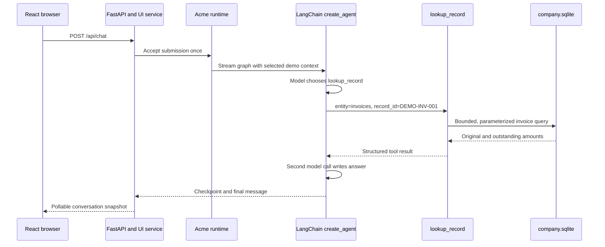

# One Acme agent run, from browser request to checked answer

This is a real local run made on 20 October 2026 with the selected **superuser
demo profile** and `qwen3-coder:30b` through Ollama. The exact question was:

> For invoice DEMO-INV-001, look up the exact recorded original total and
> outstanding balance. Cite the invoice ID.

The portable [trace extract](examples/agent_invoice_trace.json) contains the
event IDs, exact tool arguments, SQL parameters, recorded amounts and answer.
The full machine-local trace is
[`agent-smoke-2026-10-20.json`](../artifacts/agent-smoke-2026-10-20.json).
It contains the complete, paginated execution event stream for thread
`thread-806d33b06d724099a79b1f3e6bbbe221`. This one successful run shows
the path below; it is not a claim that every model answer will be correct.

## Follow the evidence in order

| Event | What actually happened | Where to read the code |
| --- | --- | --- |
| `1410 request_accepted` | The user message and submission ID were persisted before inference. | `acme/portal.py` `/api/chat`, `acme/ui_service.py`, `acme/runtime.py` |
| `1412 middleware_configured` | The standard limits, retry policy and local visibility middleware were selected. | `acme/middleware.py`, `models.toml` |
| `1413 checkpoint_loaded` | LangGraph loaded the thread state from `state/checkpoints.sqlite`. | `acme/runtime.py`, `acme/trace_hooks.py` |
| `1423 runtime_context` | The server-derived demo profile and offered tool names were attached to this model step. | `acme/middleware.py` |
| `1425 model_request` then `1429 model_response` | The model saw messages and tool schemas, then requested `lookup_record(entity='invoices', record_id='DEMO-INV-001')`. This was a model choice; no database query had occurred yet. | `acme/agent.py` |
| `1446 sql` | Python executed a bound lookup against `invoice_balances` with parameter `DEMO-INV-001`; it returned one row. | `acme/company_queries.py`, `acme/company_tools.py` |
| `1447 tool_result` | The tool returned `total_pence=120000`, `outstanding_pence=70000`, and formatted `total_gbp='1200.00'`, `outstanding_gbp='700.00'`. | `acme/company_tools.py` |
| `1463 model_request` then `1468 model_response` | The agent made a second model call with the tool result in context and produced the final answer. | `acme/agent.py`, `acme/runtime.py` |
| `1483 run_completed` | The run and readable transcript were committed. | `acme/runtime.py`, `acme/app_store.py` |

The final answer was: **“For invoice ID DEMO-INV-001, the original total was
GBP 1,200.00 and the outstanding balance is GBP 700.00.”** Its numbers agree
with the recorded SQL row and structured tool result. The trace distinguishes
the model's request, the Python tool execution, and the model's subsequent
wording. It does not expose hidden model reasoning.

## What the model may and may not choose

`build_agent` in `acme/agent.py` is the agent boundary. It selects a system
prompt and tool list for customer, company or free chat, then calls LangChain
`create_agent`. React does not import LangChain or decide permissions. The
`@tool` functions declare model-visible arguments. `ToolRuntime[RunContext]`
supplies the selected actor and state behind the scenes; the model cannot
submit a different runtime context as a tool argument.

`RuntimeContextMiddleware` can reduce the offered tools, while each company
tool checks scope again when called. `VisibilityMiddleware` records effective
model inputs and tool results. The model chooses *whether* to call a tool and
*which permitted arguments* to suggest. Python determines whether those
arguments are allowed and what the database actually returns. A displayed
answer without `sql` or `tool_result` events is not proof of retrieval.

The project uses a **selected demo profile**, not verified authentication.
The portal binds that choice to a local actor for the scenario. For writes such
as `save_report` or `update_ticket`, the tool creates a pending application
proposal. A separate person makes the decision in Execution. This is an
application workflow, not LangChain's graph interrupt middleware.

## Customer run: where the account ID comes from

A second live run selected customer `SCN-CUST-75F3A546B17E` and asked for the
current address. The [compact customer trace](examples/agent_customer_trace.json)
shows that the model called `my_profile` with **empty arguments** (`1503`).
`acme/customer_tools.py` read the selected customer ID from the server-side
persona and passed it as a bound SQL parameter (`1519`). The tool message
(`1521`) contained **Unit 22, Orchard Trade Park, Leeds, LS7 3QJ**; the final
answer (`1540`) used that value. This makes the trust boundary visible: the
model requested an account lookup, while Python chose whose account could be
looked up. Customer tools log their returned data as `tool_message` and native
tool spans; company tools additionally emit a structured `tool_result` event.

## Reproduce and inspect

Start the app as in [the portal guide](PORTAL_GUIDE.md), select **Super user**
with the all-records scope, ask the question above, then open **Execution**.
Select the conversation and inspect **Model input**, **Tool call**, **SQL**,
**Tool result**, and **Model response** in order. To test model connectivity
before a full run, execute `uv run acme doctor --inference --port 7861` when
the site already occupies port 7860. That probe verifies native tool calling;
the saved run above verifies one complete agent cycle.

The current code follows LangChain's documented
[`create_agent` loop](https://docs.langchain.com/oss/python/langchain/agents),
[`middleware` hooks](https://docs.langchain.com/oss/python/langchain/middleware/overview),
and [thread versus store memory](https://docs.langchain.com/oss/python/langchain/long-term-memory).
