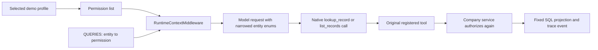

# Why the Support agent sees fewer record types

The Acme website selects a local demo identity. An employee's department
determines the saved permission list; for `EMP-136` it includes
`commercial.read` and `support.read`, but not `finance.read` or
`operations.read`. This is a scenario control, not production authentication.

The company agent uses one LangChain `create_agent` graph. It registers
`lookup_record` and `list_records` once. Both tools accept an `entity`
argument. The fixed query registry, `acme/company_queries.py::QUERIES`, maps
each entity to a read permission and parameterized SQL projection.



## What changes before the model call

`RuntimeContextMiddleware` reads the selected actor from the trusted
application session. `scoped_record_tools()` walks `QUERIES` and keeps the
entities whose required permission is in that actor's list. For a restricted
profile, it creates a Pydantic copy of each record tool's argument schema
with `entity` narrowed to those values. It passes the copied tools through
LangChain's `ModelRequest.override(tools=...)`. The original tool objects are
not mutated. When all permissions are available, the original tools are
passed through. When none of the registered record entities is permitted,
the two record tools are not offered.

In the [recorded Support run](../artifacts/return-case-employee-scoped-2026-10-21.json),
the captured `model_request` contains the same seven `entity` enum values
for both tools: `customers`, `orders`, `order_items`, `products`, `employees`,
`tickets`, and `ticket_events`. `invoices` and `shipments` are absent. The
earlier [run with the broad schema](../artifacts/return-case-employee-guided-2026-10-21.json)
attempted those two restricted reads, which the backend denied. In the
scoped run the agent made 13 completed tool calls, read the complete case
and historical policy documents, and made zero denied calls. These are
specific observed runs, not a guarantee about every model response.

## What still happens after a tool call

The copied schema limits what the model is shown. Tool execution uses the
registered `lookup_record` or `list_records` implementation. It reaches
`company_tools.execute()`, then the fixed projection in `QUERIES`; the
`company_queries.query()` function calls `authorize()` for that entity's
permission before reading SQLite. A malformed provider call, a direct
Workbench call, or a different client cannot gain permission by naming a
record that was hidden from the model. The backend check is the authority.

The **Tools** page displays general schemas for teaching and manual testing;
its direct requests are also checked against the selected actor. The
model-specific narrowed enum is captured in **Execution → Model request**.
`runtime_context.allowed_record_entities` records the derived list for the
same turn. Compare that list with actual `native_tool_started`, `sql`,
`tool_result`, and `tool_error` events. A final answer alone does not prove
which data the model read.

The Support answer still needs care with cross-team facts. The agent can
read the ticket, its events and permitted documents. It cannot open the
shipment or invoice tables. In the recorded case it labels those facts as
**document-reported**, and a superuser can independently inspect the rows.

## Reproduce the local checks

From `live_example/`:

```powershell
uv run python -m unittest tests.test_scoped_record_tools -v
uv run python -m unittest tests.test_portal.PortalJourneys.test_employee_scopes_tools_and_superuser_database -v
```

The first check verifies the narrowed Pydantic enums, the untouched
registered tools, full-access behavior and removal when no record permission
exists. The second checks that the backend rejects an employee's restricted
record access regardless of the model-facing schema. The portable run file
above supplies separate live-model evidence for this one Support question.
