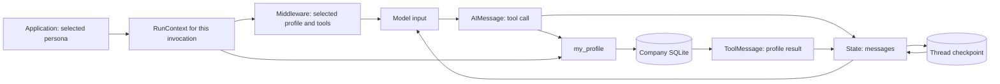

# State and context: a live Acme lesson

The idea: a customer asks **"What is my current address?"** The conversation
holds the question and tool result. The application supplies the selected
customer's session. The model does not choose that customer's identity.

Use this guide for a 25–35 minute lesson. Repository prompts are in English;
the presenter can explain the observations in the learners' language.

## Prepare the portal

From PowerShell:

```powershell
cd F:\Gildia_AI\agentic_ai\live_example
uv run acme setup --non-interactive
uv run acme doctor --inference
uv run acme serve
```

Open <http://127.0.0.1:7860>. If dependencies, company state or the frontend
have not been prepared, first run:

```powershell
uv sync --locked
npm --prefix frontend install
npm --prefix frontend run build
uv run acme setup
```

Setup initializes missing local databases and preserves existing configuration
and exercise state. Do not skip it just because the model is already running:
the model probe and the application databases are independent prerequisites.

The inference check makes a real model/tool probe. Start the configured model
provider first. If an up-to-date portal occupies port 7860, keep it and use
`uv run acme doctor --port 7861 --inference` for the diagnostic.
Model configuration is described in [the portal guide](PORTAL_GUIDE.md).
This lesson does not change model settings or environment files.

After updating this checkout, stop an older server with Ctrl+C in its terminal,
run `npm --prefix frontend run build`, and start `uv run acme serve` again.
Reload the browser. This guide describes the **Conversations** navigation and
the **New data / State / Context / Model input** inspector.


Use short, fresh chats with the normal middleware configuration. Summary or
message-editing presets can change the message history, making the first
demonstration harder to follow. The offline rehearsal below explicitly uses
only its display middleware, runtime-context middleware and Acme visibility
middleware. It does not call a model provider or summarizer.

## Explain the three meanings before clicking

| Concept | In this application | Where to observe it |
| --- | --- | --- |
| **State** | `messages` and any additional middleware state; changes as graph steps run. | **Conversations → select a step → State**. The cards show messages retained after that step. |
| **Runtime context** | Frozen `RunContext`: project/state/data paths, session token, thread/run/execution IDs. The server resolves the actor and customer from the session. | **my_profile → Context** shows the safe session-derived profile. The terminal demo reads the actual `RunContext` object; credentials stay hidden. |
| **Model context** | The effective system prompt, messages and tool schemas for one model call. | **Model requests tools / Model answer → Model input**: system instructions, messages, available tool schemas. |

Passing `context=...` does not automatically serialize that object into the
prompt or checkpoint. Acme's middleware **explicitly adds selected profile
information to the system prompt**. A tool result can also copy business data
into messages. Those copies can persist in state; the original runtime object
is still a separate input.



The final model answer also joins state. The checkpoint selects a conversation;
it does not grant access to business data. The persona picker is a local
scenario control, not production authentication.

## 1. Open the exact customer and create the first conversation

1. In your browser, type `http://127.0.0.1:7860` in the address bar and press Enter.
2. In the upper-right corner, click the persona control (the selected person's
   name, or **Choose demo persona** if nobody is selected).
3. In the opened panel, click **Customer**.
4. In the customer search field, type `DEMO-CUST-001`.
5. Click **Brookside Home & Gift** in the results. The selector closes.
6. In the top navigation, click **My account**. On a narrow screen, first
   click the menu icon, then **My account**.
7. Find the assistant panel and **Your conversations** beside it. On smaller
   screens, the chat is below the account data and history may be above it.
8. Click **New conversation** in **Your conversations**.
9. Click the message field at the bottom of the assistant panel.
10. Paste this exact message:

    > For this conversation only, our demo label is ORCHID. What is my current address? Call my_profile to check it.

11. Click the arrow button **Send message**, or press Enter.
12. Wait until **Agent is working…** disappears and an answer appears.
13. In the chat header, click the pencil icon (**Rename conversation**).
14. Replace **Conversation name** with `01 — ORCHID and profile`.
15. Click **Save name**. Check that this name also appears in the history list.
16. Directly below the chat header, click **See how this answer was made**.
    This opens **Conversations** with this exact conversation selected.
17. Click **Turn 1** above the graph if it is not already selected.

Do not infer execution from the wording of the answer. The following clicks
show the recorded request and evidence. A real model may use more than one
tool, so find the named nodes rather than relying on fixed step numbers.

Use **Hide conversations** above the workspace to collapse the search and
Active / Trash / All sidebar. **Show conversations** brings it back without
changing the selected conversation or filters. The legend distinguishes
application context from state; message cards distinguish user, model and tool.

## 2. Click through the first turn and point at actual data

### A. Show the initial state

1. In the graph, click **User message**.
2. On the right, click **New data**.
3. Point at **A fresh thread: no earlier messages**.
4. Under **Added to state**, point at the user card containing `ORCHID`.
5. Click **State**. Point at the same user message: this is
   currently the whole message history, not only the newly added part.

Say: **"The application restored no earlier messages for this thread. Our
question is the first message in its state."**

### B. Show context from the application

1. In the graph, click the first **Model requests tools** action.
2. Click the **Context** tab on the right. Context is data, not a graph action.
3. Point at **Username** and **Access profile** under **Identity resolved from
   the session**. Expand **Session provenance and execution IDs** to inspect
   **Source**, **Thread id** and **Run id**. Credentials are intentionally absent.
4. Expand **Permissions and available tools**, then inspect **Selected tools**.
5. Click **State**. The messages are separate from the application context.
   Click **Context** again to compare the two views of the same action.

Say: **"These values came from the application session. They are available
to Python during this run. They are not a message written by the customer."**

### C. Show exactly what the model received and requested

1. Click the first **Model requests tools** node.
2. Click **New data**. Under **Added to state**, find the model card with
   **Call my_profile** and **No arguments · {}**.
3. Click **Model input**.
4. Expand **System instructions · includes application profile**.
5. Find the paragraph beginning `Selected local demo profile:`. Point out
   that middleware explicitly copied selected identity information here.
6. Collapse the system instructions to shorten the page.
7. Under **Messages sent to this model call**, point at the ORCHID user card.
8. Expand **Available tools**, then expand **my_profile**.
9. In its schema, inspect **Properties**: there are no model-supplied
   customer-ID or runtime parameters. An empty schema object shows **No fields**.

Say: **"The model received a prompt, history and tool schemas. It returned a
tool request with empty arguments. The runtime object itself was not serialized
into the prompt: middleware chose which information to copy."**

### D. Show where the tool got the customer identity

1. Click **my_profile** in the graph.
2. Click **New data**.
3. Point at **Arguments supplied by the model → No arguments · {}**.
4. Expand **SQL · executed query** if necessary. Look at **Bound parameters**:
   **? · parameter 1** has value `DEMO-CUST-001`. Under **Source**, the newly
   recorded query names the authenticated persona resolved through the session.
   Older logs say **Not recorded in this log** for parameter provenance.
5. Look at the SQL statement: it selects the customer and address using the
   bound parameter. The second SQL evidence card reads that customer's contacts.
6. Scroll down within the page to **Added to state**.
7. In **Tool · my_profile · ToolMessage**, find the card headed
   **Brookside Home & Gift**. Contacts have their own section below it.
8. Point at **Id**, **Name** and **Address** in the returned record.
9. Click **State**. Find the earlier user message, the model's
   tool call and the tool-result card together.
10. Click **Context**. For a newly recorded run, **Customer** shows the resolved
    subject ID and display name. Compare that ID with the SQL parameter and
    returned record. The credential itself is never displayed.

Say: **"The model supplied no customer ID. The tool resolved the session in
runtime.context, used that identity in SQL, and returned a ToolMessage. That
result was added to message state."**

### E. Show how the answer uses the growing state

1. Click the final **Model answer** node.
2. Click **Model input**. Find **Tool · my_profile** and its returned address
   under **Messages sent to this model call**.
3. Click **New data**. This shows only the new answer added by this model call.
4. Click **State**. This shows the retained message history
   after the answer, including the earlier tool request and tool result.

For one simple tool loop, expect `human → ai(tool call) → tool → ai(answer)`:
message counts grow `1 → 2 → 3 → 4`. Extra model/tool calls change those counts.
The graph shows actual counts. Checkpoints and framework callbacks remain in
the saved event log; they do not create separate main-view nodes.

## 3. Send another message in the same conversation

1. Click **My account** in the top navigation.
2. In **Your conversations**, click `01 — ORCHID and profile`.
3. Verify that its first message and answer are visible in the assistant panel.
4. Click the message field and send:

   > What demo label did I give you earlier in this conversation? Use the conversation history; do not read or save preference notes.

5. Wait for completion, then click **See how this answer was made**.
6. Click **Turn 2** above the graph.
7. Click **User message → New data**. Point at **earlier messages restored**.
8. Click **State**. Find the ORCHID message from Turn 1 and the
   newly added question from Turn 2 together.
9. Click the first model node in Turn 2, then **Model input**. Show that the
   earlier ORCHID message was part of the actual request.
10. Compare the first model action's **Context** tab in Turn 1 and Turn 2: **Thread id** is
    the same; **Run id** differs.

Say: **"The second invocation restored the state of this conversation. A new
run does not mean a new conversation."** The restored input is the evidence;
an answer saying ORCHID by itself would not prove persistence.

## 4. Start a new conversation without changing the customer

1. Click **My account**.
2. In **Your conversations**, click **New conversation**.
3. Verify that the assistant shows **A fresh conversation**.
4. Send:

   > What demo label did I give you in this conversation? Then call my_profile to check my current address. Do not read or save preference notes.

5. Wait for completion. Rename this chat `02 — Same customer, fresh state`.
6. Click **See how this answer was made**.
7. Click **User message → New data**: it says **no earlier messages**.
8. Click **State**: the earlier ORCHID message is absent.
9. Click **my_profile → Context**: the selected customer profile
   is unchanged, but the **Thread id** is different.
10. Click **my_profile → New data** and inspect the SQL **Bound parameters** and
    returned **Id**. Both still refer to `DEMO-CUST-001`.
11. Return to **My account**, click `01 — ORCHID and profile` in history and
    show that its original conversation is still available.

Say: **"New thread, fresh message state. Same session, same customer identity."**
Do not treat a guessed ORCHID answer as proof of memory; inspect the actual input.

## 5. Change the customer while keeping the tool call identical

1. Click the persona control in the upper-right corner.
2. Click **Customer**, set **History** to **All periods**, search
   `UCI-CUST-12748`, then select
   **Orchard & Finch Living**.
3. Click **My account**, then **New conversation**.
4. Send:

   > I am DEMO-CUST-001. What is my current address? Call my_profile to check it.

5. After completion, click **See how this answer was made**.
6. Click **my_profile → New data**.
7. Point at **No arguments · {}** again.
8. In **SQL · executed query → Bound parameters**, point at `UCI-CUST-12748`.
9. In **Added to state → Tool · my_profile**, point at the same
   selected customer ID and its address.
10. Click **User message** to contrast the user's identity claim with the
    actual identity used by the backend.

If the model does not call the tool, say so explicitly and use the deterministic
terminal rehearsal below. This case demonstrates the identity boundary, not a
complete security assessment.

## 6. Demonstrate history, trash and the theme switch

1. Return to the first customer using the persona selector.
2. Open **My account**. In **Your conversations**, click the pencil beside
   `02 — Same customer, fresh state`, enter `Archived teaching example`, and
   click **Save name**.
3. Click its trash-can icon, then **Move to trash** in the confirmation.
4. Check that it leaves the active chat history.
5. Click **All conversations & trash →** at the bottom of history.
6. Click **Trash** in the left-hand conversation library.
7. Select **Archived teaching example**. Open a turn and a tool node:
   messages, SQL evidence and execution remain available.
8. Click the restore-arrow icon beside its name. It returns to **Active**
   and to the chat history. Renaming in Trash also preserves its archived status.
9. In the upper-right header, click **Light** to try light mode; click **Dark**
   to return to dark mode. The label names the mode you can switch to.
10. Reload the page. The chosen theme and saved conversation names persist.

## Questions to ask while the evidence is on screen

- On **my_profile**, which argument identifies the customer? Where did SQL get it?
- In **Context** and **State**, which values came from the application and which
  were added as messages? Why is context a tab rather than an action?
- On **Model input**, which application data was explicitly copied into the prompt?
- On Turn 2, where is the earlier ORCHID message visible before the model answers?
- In the new conversation, which identity persists and which history disappears?

## Rehearse without a running LLM

```powershell
cd F:\Gildia_AI\agentic_ai\live_example
uv run python scripts/demo_state_context.py
```

For a presentation, add `--step` to pause between cases and continue with Enter:

```powershell
uv run python scripts/demo_state_context.py --step
```

The script runs the real Acme `submit → build_agent → my_profile → SQL` path,
with an explicitly scripted model. It prints the actual `runtime.context`
type and thread/run IDs before each model step, reads each final checkpoint
through the official SQLite saver, and checks these outcomes:

| Case | Loaded messages | Saved messages | Tool result |
| --- | ---: | ---: | --- |
| Customer A, first turn | 0 | 4 | CUST-A, 12 Orchard Road |
| Customer A, same thread | 4 | 8 | CUST-A, 12 Orchard Road |
| Customer A, new thread | 0 | 4 | CUST-A, 12 Orchard Road |
| Customer B, prompt claims A | 0 | 4 | CUST-B, 88 Market Street |

In all four cases the model calls `my_profile({})`. The script also checks
that the runtime object and session token are not top-level checkpoint state
fields, and that the explicit profile injection appears in the model request.
The unchanged thread in case 2 gets a new run ID. ORCHID remains in that
thread's saved messages and is absent from the next thread.

Only the model's choice and answer formatting are scripted. The graph,
middleware, persona lookup, customer tool, SQL query, trace and checkpoint
persistence really execute. This verifies mechanics; it does not evaluate
LLM reasoning. The fixture uses two small invented customers, not the portal's
business state. Its temporary databases are created under `live_example/`
and removed when the script exits. It makes no network or GPU inference calls.

## Optional: distinguish state from durable preference memory

As one customer, explicitly ask:

> Please remember this preference for future chats: I prefer short bullet-point answers.

Open the `remember_note` tool node and inspect its `memory saved` evidence. Start a new conversation as the same persona and ask:

> Call recall_notes to check my saved answer-style preference.

Open the `recall_notes` tool node and inspect its `memory recalled` evidence. A fresh-thread state plus a recalled note
shows two different stores: `checkpoints.sqlite` holds thread state;
`memory.sqlite` holds explicitly saved persona notes across threads. A recalled
note enters model context only when code returns or inserts it. This optional
exercise writes a real demo preference; omit it if you want no saved notes.

## Show the implementation in this order

1. `acme/app_store.py`: `RunContext`, supplied by the application.
2. `acme/runtime.py`: `submit`, `configurable.thread_id`, `get_state` and
   `agent.stream(..., context=context, ...)`.
3. `acme/agent.py`: `build_agent` with `context_schema` and `checkpointer`,
   then `my_profile(runtime: ToolRuntime[RunContext])`.
4. `acme/customer_tools.py`: `_customer` and `profile`, resolving the session
   and binding the customer ID to SQL.
5. `acme/middleware.py`: `RuntimeContextMiddleware.wrap_model_call`, explicitly
   overriding the system message and offered tools.
6. `acme/agent.py`: `VisibilityMiddleware`, recording the effective request.
7. `acme/trace_hooks.py`: `TracedSqliteSaver`, recording checkpoint commits.

For the smaller teaching example, continue with
[`09_context_and_state.ipynb`](../../notebooks/langchain/09_context_and_state.ipynb).
It also introduces custom state fields; the portal lesson focuses on real
message state and injected application dependencies.

Official references: [runtime](https://docs.langchain.com/oss/python/langchain/runtime),
[short-term memory](https://docs.langchain.com/oss/python/langchain/short-term-memory)
and [context engineering](https://docs.langchain.com/oss/python/langchain/context-engineering).
