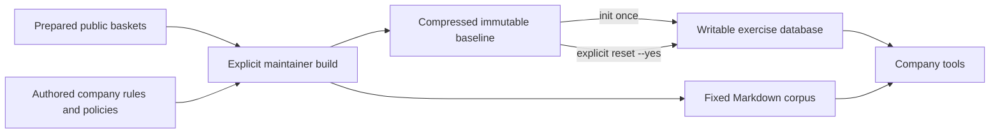

# Prepare, verify and reset the company

## Learner path

From the independent project root, install the locked environment and initialize the
included baseline. This needs no Docker, SQL server, model, API key or raw source download.

```powershell
uv sync --locked
uv run --locked acme company verify
uv run --locked acme company init
```

The compressed baseline is `data/company/baseline/company.sqlite.gz`. Initialization
checks its identity and the fixed document corpus, then decompresses it to
`state/company.sqlite`. It does not regenerate employees, transactions or documents.
The baseline, reports and Markdown are separate from the writable exercise database.
Use [the dictionary](data_dictionary.md) to inspect records with a SQLite reader.
Run `acme setup` and `acme serve` for local login and the [learning UI](learning_app.md).



The shipped database archive is about 47 MB and expands to about 310 MB. Keep at least
1 GB free for the installed environment, exercise copy and temporary verification;
maintainer rebuilds and retained independent copies need additional space.

Running `init` again preserves an existing exercise database byte for byte. Its
`state/baseline.json` receipt must identify the current baseline. A missing or different
receipt produces an error and preserves the existing database. It is not silently
migrated, reset or overwritten. `.env`, application conversations and unrelated files
are not touched by company initialization.

## Explicit exercise reset

Close any SQLite editor or application holding the exercise database first. Reset
replaces this named company's exercise records, including edited tickets:

```powershell
uv run --locked acme company reset --yes
```

Without `--yes`, the CLI refuses to reset. This resets only `state/company.sqlite` and
its baseline receipt; unrelated files remain. The immutable compressed baseline and
company documents remain unchanged. Later conversation/application state will have a
separate lifecycle. To keep multiple independent exercise runs, choose another directory:

```powershell
uv run --locked acme company init --state-dir state/exercise-two
```

The local `.company-initialize.lock` prevents overlapping initialization/reset. If a
process crashes, inspect whether it is still running before removing a leftover lock;
do not use reset to bypass a live writer. Permission errors or open-file errors should
be resolved at that path before repeating the command.

## Maintainer rebuild

G03's prepared public rows are sufficient. The original workbook and network are not
needed. Build into a **new** directory; an existing baseline or corpus is refused:

```powershell
uv run --locked acme company build --profile fixture --output-dir artifacts/fixture-check
uv run --locked acme company verify --data-dir artifacts/fixture-check
uv run --locked acme company build --profile full --output-dir artifacts/rebuilt-data
uv run --locked acme company verify --data-dir artifacts/rebuilt-data
```

Both profiles use the same schema, operational rules, validators and document builder.
The fixture chooses the first 40 eligible invoice groups in deterministic source order,
plus all authored business scenarios; it reduces employee and document counts. The
full build retains all 15,201 eligible source invoices and their 259,639 lines before
adding the small DEMO namespace. No row sampling breaks source baskets.

Each output bundle contains `company/baseline/` and `documents/`. The baseline folder
holds the compressed database, content manifest, preparation report and validation report.
No volatile timestamp enters a deterministic content hash. Every table is hashed over
canonical ordered rows; document bytes and catalog have separate hashes. Compare
`content_sha256`, all table hashes and the document catalog hash between rebuilds.
Compressed SQLite bytes are also pinned for distribution; logical identity remains
the cross-build criterion because SQLite/library versions can affect physical layout.

Maintain the pinned source data, rule version and authored templates together. Review
any changes before replacing the published bundle. `build` never changes existing
exercise state. Normal startup never runs `build` or makes document-generation calls.

## Validation scope

`company verify` decompresses to a temporary directory and opens the database read-only.
It checks all 35 tables, foreign keys, financial reconciliation, life-cycle ordering,
stock conservation, complete source baskets, forecasting cutoffs, document metadata
and facts, and scenario evidence. It recomputes logical hashes instead of trusting a
saved green report. Temporary verification needs disk space for an uncompressed copy.

```powershell
uv run --locked python -m unittest discover -s tests -v
uv run --locked ruff check .
```

Tests deliberately corrupt totals, stock and document facts; test forecast sensitivity
to past versus future observations; and mutate, preserve and explicitly reset exercise
state. They establish data behavior, not future agent/tool/authentication correctness.
The read-only baseline is an application convention with verified immutable content,
not OS-level protection against a person editing repository files.
